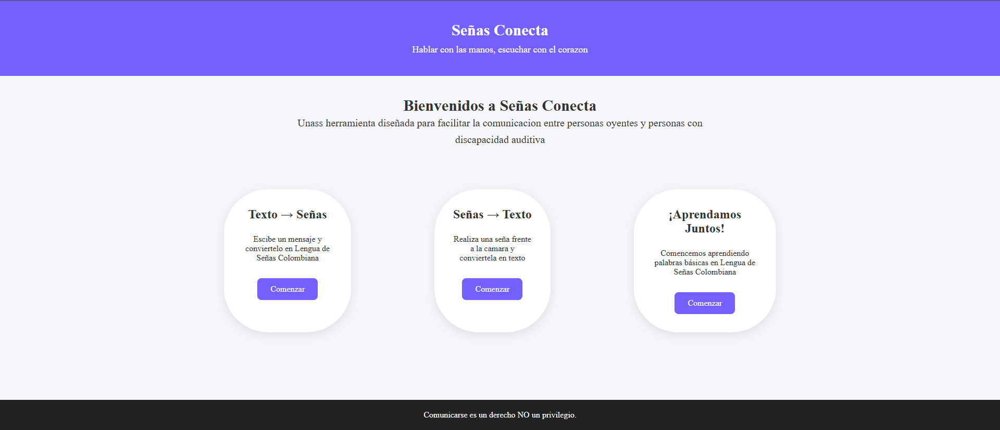
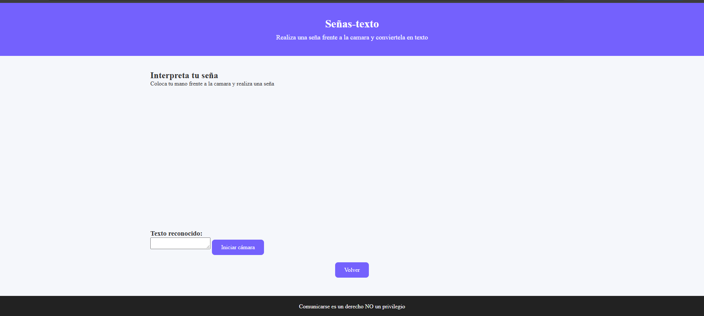
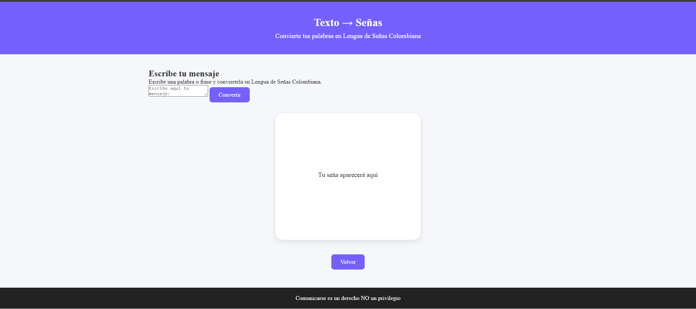
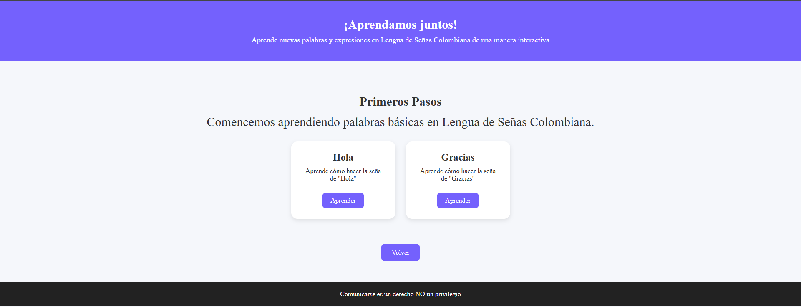

SENAS CONECTA

**Descripción**
Facilitar la comunicación para las personas con discapacidad auditiva

```treeview
index-html/
css/
externo.css
evidencias/
aprender.PNG
gestoTexto.PNG
paginaPrincipal.PNG
textoGesto.PNG
img/
avatar-hola.png
js/
script.js
texto-gestos.js
models/
hand_landmarker.task
paginas/
aprender.html
señas-texto.html
texto-señas.html
README.md


Evidencias





